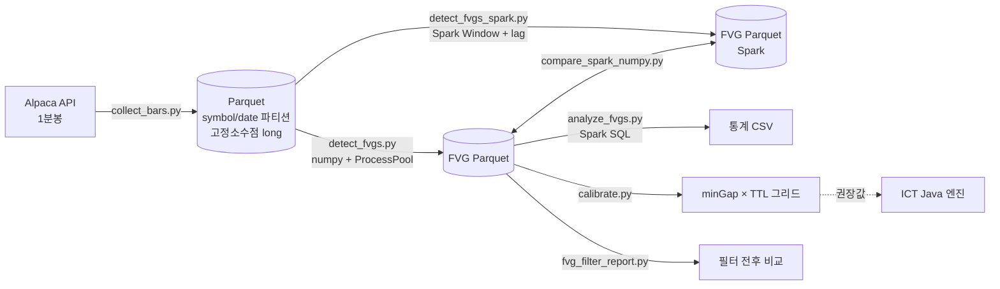

# fvg-spark

**PySpark 기반 나스닥 FVG(Fair Value Gap) 신호 대용량 백테스트·임계값 보정**

DCCS 410 Bigdata Distributed Processing System 기말 프로젝트 · 박상언 (2022270686)

실시간 FVG 탐지 엔진([ICT](https://github.com/PACKSangEon/ICT), Java 21)의 탐지 임계값과 유효 시간(TTL)은 지금까지 손으로 정한 값입니다. 이 저장소는 수년치 1분봉을 대량으로 분석해 그 값을 데이터로 보정하는 **오프라인 분석 트랙**입니다.

| | ICT (Java 엔진) | fvg-spark (이 저장소) |
|---|---|---|
| 역할 | 실시간 틱 수신 → 캔들 → FVG 탐지 → AI 필터 | 과거 데이터 대량 백테스트 → 통계 → 임계값·모델 |
| 처리 방식 | 저지연 단일 writer 스레드 | numpy 병렬 처리 + PySpark |
| 결과 전달 | — | 권장 minGap·TTL, (예정) 품질 모델 계수 |

---

## FVG 규칙 (Java 엔진과 동일)

가격은 Java 엔진과 같은 **고정소수점 long** (1 unit = $0.0001)으로 저장하고 비교합니다. double 비교 오차로 경계값 판정이 달라지는 것을 막기 위해서입니다.

| 유형 | 조건 | 영역 [bottom, top] |
|---|---|---|
| BULLISH | `c[t-2].high < c[t].low` | `[c[t-2].high, c[t].low]` |
| BEARISH | `c[t-2].low > c[t].high` | `[c[t].high, c[t-2].low]` |

완충(mitigation) 판정은 FVG가 생긴 뒤 TTL개(기본 200개) 캔들을 봅니다.

| 상태 | 뜻 |
|---|---|
| FULL | 반대편 경계까지 가격이 들어옴 (완전히 메워짐) |
| PARTIAL | 일부만 메워짐, `fill_permille` = 최대 침투 깊이 ÷ 갭 × 1000 |
| EXPIRED | TTL 안에 전혀 메워지지 않음 |

---

## 파이프라인



| 단계 | 스크립트 | 내용 |
|---|---|---|
| M1 수집 | `collect_bars.py` | Alpaca Market Data API v2, 월 단위 페이지네이션, 429 재시도, `partitionBy(symbol, date)` Parquet |
| M2 탐지 | `detect_fvgs.py` | 3-캔들 탐지 + 완충 시뮬레이션 (numpy, 심볼별 ProcessPoolExecutor) |
| M2 탐지 (Spark) | `detect_fvgs_spark.py` | 같은 규칙을 Spark `Window.partitionBy("symbol").orderBy("ts_micros")` + `lag`, `rowsBetween(1, TTL)` 로 구현 (Python UDF 없음) |
| 검증 | `compare_spark_numpy.py` | numpy 결과와 Spark 결과를 키 단위로 비교 |
| M3 집계 | `analyze_fvgs.py` | Spark SQL 집계 4종: 심볼·방향별 통계, 갭 크기별 완충률, 시간대별 완충률, 수명 분포 |
| M3 보정 | `calibrate.py` | minGap × TTL 그리드 탐색, 권장 조합 산출 |
| 점검 | `fvg_filter_report.py` | 엔진 최소 갭·정규장·같은 거래일·연속 3분 필터별 FVG 수와 완충률, 분봉 누락 점검 |
| 교차 검증 | `cross_validate.py` | Java 엔진 탐지 로직과 비교 |

---

## 폴더 구조

```
fvg-spark/
├── collect/            # Alpaca 클라이언트, Parquet 저장 (fixed-point 변환)
├── detect/
│   ├── fvg_pipeline.py # numpy 탐지 + 완충 시뮬레이션
│   └── spark_detect.py # PySpark 탐지 + 완충 판정 (Window + lag)
├── analyze/            # Spark SQL 집계 함수
├── collect_bars.py     # M1 수집
├── detect_fvgs.py      # M2 탐지 (numpy)
├── detect_fvgs_spark.py# M2 탐지 (Spark)
├── compare_spark_numpy.py
├── analyze_fvgs.py     # M3 Spark SQL 집계
├── calibrate.py        # M3 임계값 보정
├── fvg_filter_report.py
├── cross_validate.py
├── spark_utils.py      # SparkSession 공통 설정 (Windows winutils 자동 처리)
├── config.py           # 심볼·기간·경로·PRICE_SCALE
└── data/               # 생성 데이터 (git 제외)
```

---

## 실행 방법

### 1. 환경

- Python 3.10 이상, Java 17 또는 21 (PySpark 실행용)
- Windows에서 Spark로 Parquet을 쓰려면 `C:\winutils\bin\winutils.exe` 가 필요합니다. 있으면 `spark_utils.py` 가 자동으로 설정합니다. WSL·Linux·macOS는 추가 설정이 필요 없습니다.

```bash
pip install -r requirements.txt
cp .env.example .env      # ALPACA_KEY, ALPACA_SECRET 입력
```

### 2. 수집 → 탐지 → 분석

```bash
python collect_bars.py                 # config.py 의 심볼·기간 (이미 받은 월은 건너뜀)
python detect_fvgs.py                  # numpy 탐지
python detect_fvgs_spark.py            # Spark 탐지
python compare_spark_numpy.py          # 두 결과 일치 확인 (일치하면 종료 코드 0)
python analyze_fvgs.py                 # Spark SQL 집계 → data/stats/*.csv
python calibrate.py                    # 임계값 그리드 → data/calibration/*.csv
python fvg_filter_report.py            # 필터 전후 비교 → data/stats/fvg_filter_report.csv
```

### 3. 종목 확대

`symbols.txt` (한 줄에 심볼 하나)를 만들면 `config.SYMBOLS` 대신 그 목록을 씁니다. 수집기는 이미 받은 (심볼, 월)을 건너뛰므로 새 종목만 추가로 받습니다.

```bash
python collect_bars.py                 # symbols.txt 의 종목 수집
python collect_bars.py --feed sip --outdir data/parquet_sip   # SIP 피드로 따로 받기
```

---

## 현재 결과 (필터 적용 전)

| 항목 | 값 |
|---|---|
| 종목 | 10개 (AAPL, MSFT, NVDA, AMZN, META, GOOGL, TSLA, AVGO, COST, NFLX) |
| 기간 | 2022-01-01 ~ 2025-12-31 |
| 1분봉 | 약 3,200,000행 (177MB, Snappy Parquet), IEX 피드 |
| 탐지 FVG | 1,723,430건 (최소 갭 필터 없음) |
| 완충률 (TTL 200봉) | 91.23% |
| numpy 탐지 시간 | 약 6.4초 (10종목, ProcessPoolExecutor) |

필터 적용 후 수치와 Spark 처리 시간 비교는 `fvg_filter_report.py`, `detect_fvgs_spark.py` 실행 후 갱신합니다.

### 알려진 한계

- **IEX 피드:** 무료 IEX 피드는 전체 거래의 일부만 담아 거래가 없는 분이 빠지고 캔들 범위가 좁습니다. FVG가 실제보다 많이 잡힐 수 있어 SIP 피드와 비교할 예정입니다.
- **빈 분봉:** Java 엔진은 빈 구간을 직전 종가 캔들로 채우지만, 이 분석은 받은 분봉만 이어 붙입니다. `fvg_filter_report.py` 의 "연속 3분" 필터로 영향을 확인합니다.
- **Spark 버전의 lifetime:** Window 집계로는 "처음 메워진 캔들 위치"를 구할 수 없어 FULL 의 `lifetime_bars` 는 비워 둡니다. TTL 보정은 numpy 결과를 씁니다.

---

## 로드맵

| 마일스톤 | 내용 | 상태 |
|---|---|---|
| M1 | Alpaca 1분봉 수집, 고정소수점 Parquet | 완료 |
| M2 | FVG 탐지·완충 시뮬레이션 (numpy, Spark) | 완료 |
| M3 | Spark SQL 집계, minGap × TTL 보정 | 완료 |
| M4 | 품질 feature 표, Spark ML (VectorAssembler + LogisticRegression), 계수 내보내기 | 예정 |
| M5 | 처리 시간 비교 (numpy 단일 / ProcessPool / Spark `local[1]`·`local[*]`), Java 백테스트 결과 비교 | 예정 |
| 확장 | 틱 데이터로 100ms 캔들 재구성 | 확장 실험 |

---

## 데이터 정책

원본 시세 데이터(`data/`)는 데이터 제공자 약관에 따라 저장소에 포함하지 않습니다. 코드와 집계 결과만 공개합니다.
